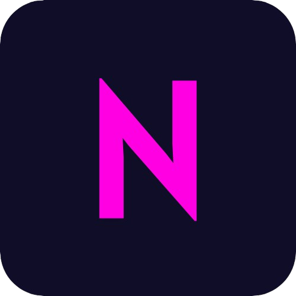

<div align="center">



# Neram

### A calm, focused workspace for tracking time and getting meaningful work done.

Neram is an open-source desktop productivity app for time logging, projects,
tasks, Pomodoro sessions, and personal analytics — designed to help you
understand where your time goes without getting in your way.

<p>
  <a href="https://github.com/AthithianV/neram/releases">Releases</a> ·
  <a href="https://github.com/AthithianV/neram/issues">Report a bug</a> ·
  <a href="CONTRIBUTING.md">Contribute</a>
</p>


</div>

## Why Neram?

Most productivity tools make you manage the tool before you can do the work.
Neram keeps the workflow close to the essentials: choose what you are working
on, start the clock, capture the work, and use the resulting data to make better
decisions.

Your data is stored locally, making Neram a good fit for focused individual
work, freelancing, and project-based teams who want a lightweight desktop tool.

## Highlights

| | Capability | What it gives you |
| --- | --- | --- |
| ⏱️ | Time tracking | Record sessions with start time, end time, duration, and breaks. |
| ▶️ | Focus timer | Start, pause, resume, and stop active work sessions. |
| 🗂️ | Projects and tasks | Organize work with projects, tags, task states, and a Kanban-style view. |
| 🍅 | Pomodoro | Configure focus and break intervals to support deliberate work. |
| 📊 | Analytics | Explore time spent across projects, tasks, and tags. |
| 🎨 | Personal settings | Adjust themes and date/time formats to suit your workflow. |
| 💾 | Local-first storage | Keep your productivity data on your own device with SQLite. |

## Product direction

Neram is actively evolving. The longer-term direction includes richer date-range
filters, data exports, invoicing support, and optional cloud-drive sync. These
areas are tracked in the repository and may not be available in the current
release.

## Installation

Download the latest release for your platform from the
[GitHub Releases page](https://github.com/AthithianV/neram/releases).

> Neram is currently in early development. Back up important local application
> data before testing development or pre-release builds.

## Development

### Requirements

- [Node.js](https://nodejs.org/) and npm
- [Rust](https://www.rust-lang.org/tools/install) and Cargo
- [Tauri prerequisites](https://v2.tauri.app/start/prerequisites/) for your OS
- Git

Neram uses SQLite locally, so no separate database server is required.

### Run locally

```bash
git clone https://github.com/AthithianV/neram.git
cd neram
npm install
npm run tauri dev
```

### Build and test

```bash
npm run build
cargo test --manifest-path src-tauri/Cargo.toml
```

The frontend is built with Vite and TypeScript. The desktop layer is powered
by Rust and Tauri.

## Technology

- **Desktop:** Tauri 2, Rust
- **Frontend:** React, TypeScript, Vite
- **UI:** Tailwind CSS, Radix UI, shadcn/ui, Lucide
- **State and data:** Zustand, TanStack Query, SeaORM, SQLite
- **Forms and validation:** React Hook Form, Zod
- **Charts and time:** Chart.js, date-fns, Day.js

## Contributing

Contributions are welcome — from bug fixes and UI improvements to documentation
and feature ideas.

Please read [CONTRIBUTING.md](CONTRIBUTING.md) before opening a pull request.
For community expectations, see the [Code of Conduct](CODE_OF_CONDUCT.md). If
you discover a security issue, follow [SECURITY.md](SECURITY.md) instead of
opening a public issue.

## Project documents

- [Changelog](CHANGELOG.md)
- [Contributing guide](CONTRIBUTING.md)
- [Code of Conduct](CODE_OF_CONDUCT.md)
- [Security Policy](SECURITY.md)
- [MIT License](LICENSE)

## License

Neram is released under the [MIT License](LICENSE).

<div align="center">

Made with focus by [Athithian V](https://github.com/AthithianV)

</div>
